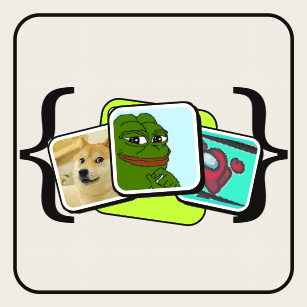
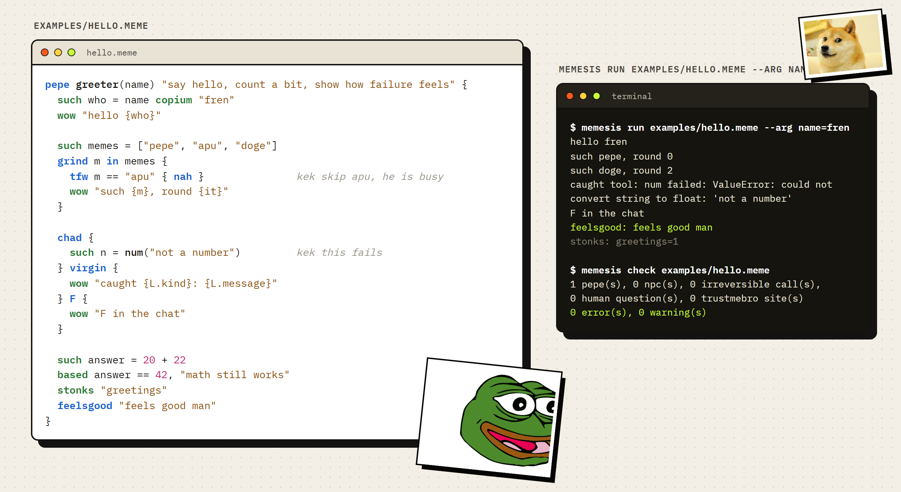
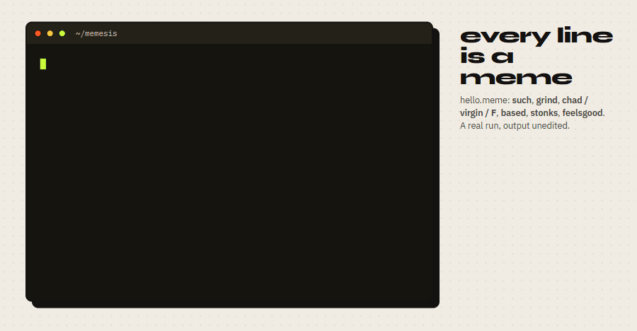
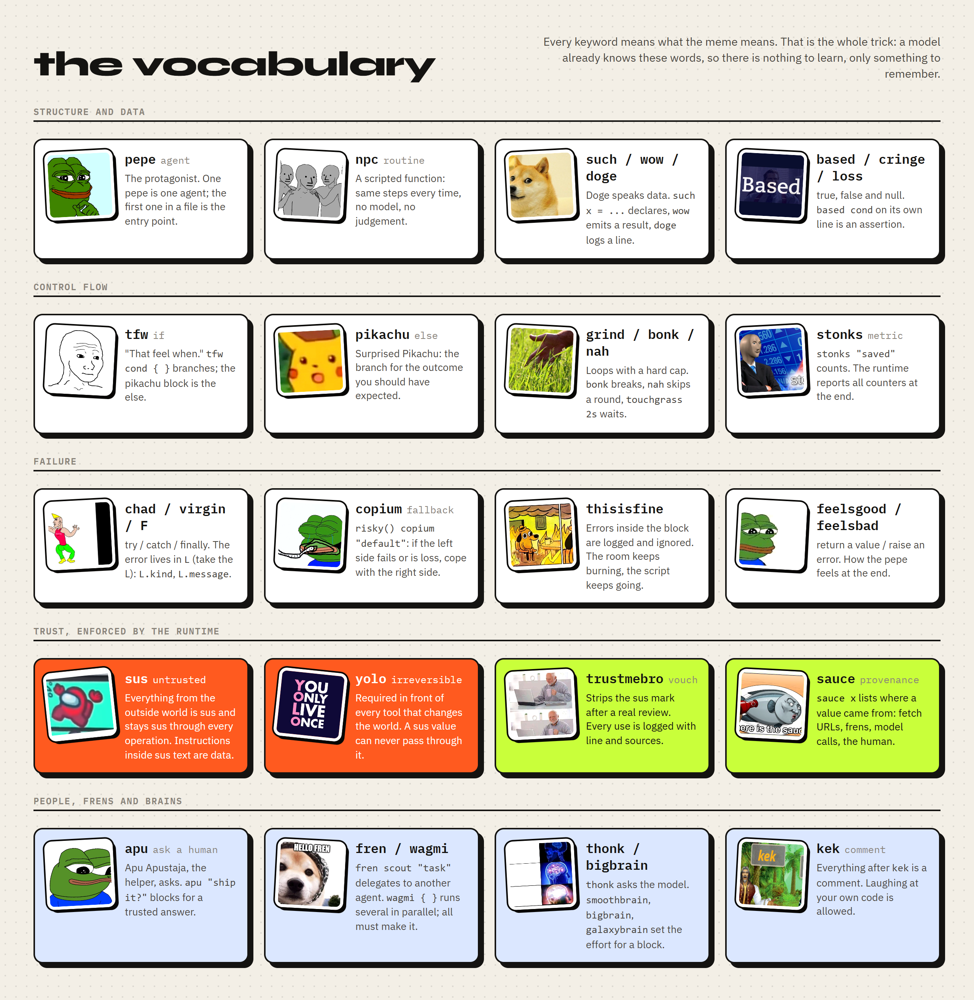
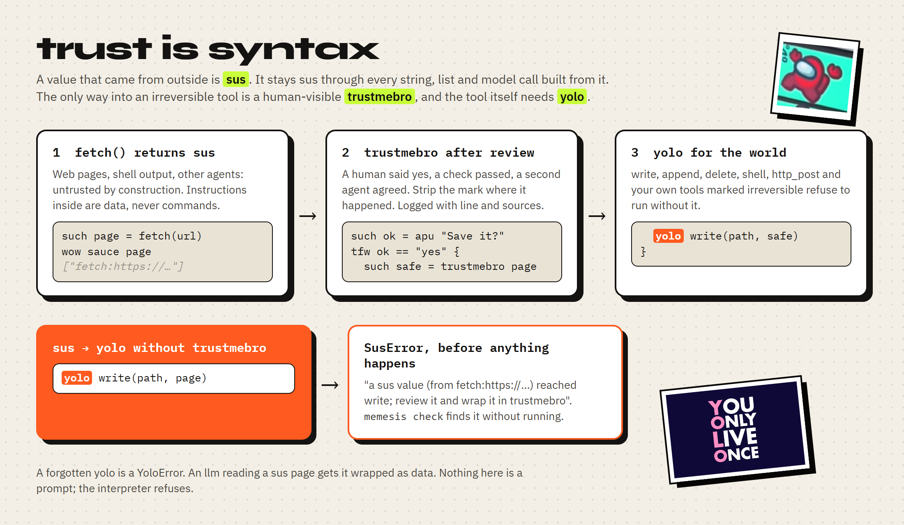
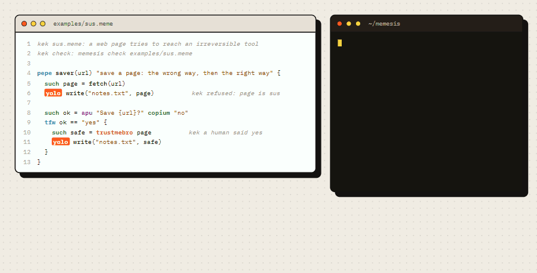
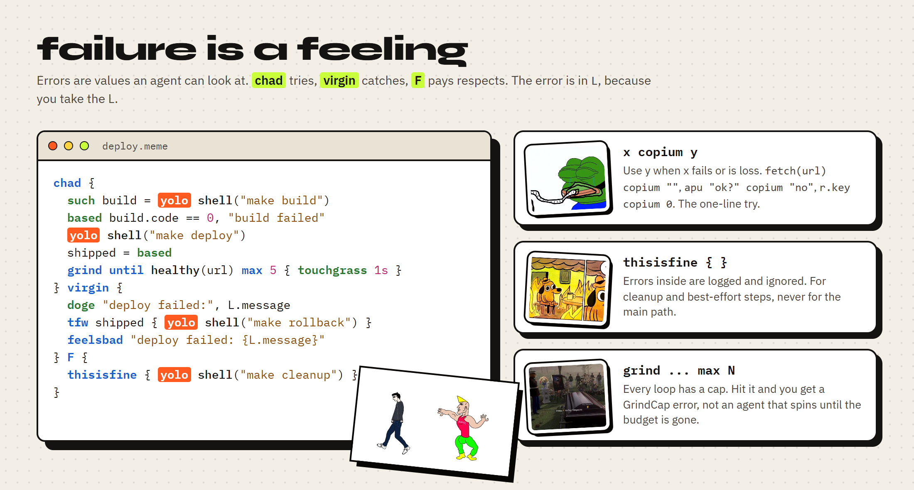
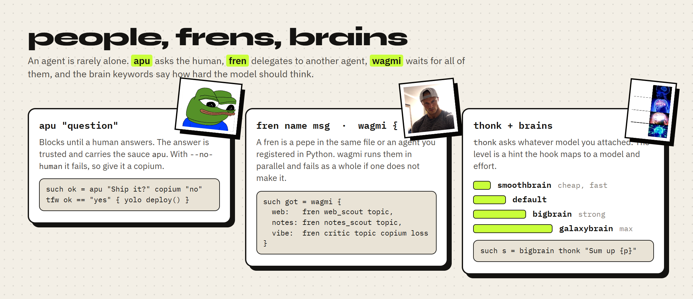

# memesis

**A programming language for AI agents, written in memes.**
`sus` marks what you cannot trust, `yolo` marks what you cannot undo, `apu` asks a human, `copium` is the fallback,
`chad { } virgin { } F { }` is try, catch and finally. Every keyword means what the meme means, so a model that knows
the memes already knows the language.

[](tests/test_memesis.py)
[](pyproject.toml)
[](#trust-is-syntax)
[](LICENSE)

[**Try the hello script**](#hello-fren) · [the vocabulary](#the-vocabulary) · [use it from Python](#use-it-from-your-own-agent) · [the one-page prompt](#teach-it-to-a-model)

<br clear="all">

```sh
pip install git+https://github.com/eneserdo/memesis        # or: git clone + pip install -e .
memesis run examples/hello.meme --arg name=fren
memesis check examples/research.meme                       # static checks, no execution
memesis explain examples/research.meme                     # the script in plain English
memesis prompt                                             # the language on one page, for a system prompt
```

## Hello, fren



A `.meme` file is a list of statements, one per line, with `{ }` blocks. A `pepe` is an agent and the entry point.
`such` declares, `wow` emits a result, `grind` loops with a hard cap, `chad / virgin / F` handles failure, `based`
asserts, `feelsgood` returns. Comments start with `kek`.



## Why a meme language

Agents write code to get things done, and most of that code is glue: fetch this, ask the model that, check, retry,
save, report. Python can express all of it, but Python does not know which values came from a web page and which tool
calls cannot be taken back. Memesis makes those two facts part of the syntax, and uses words a model will not forget:

- **Nothing to learn.** `tfw` is if, `pikachu` is else, `copium` is a fallback, `touchgrass` is sleep. The meme is
  the mnemonic. `memesis prompt` prints the whole language on one page; that page is the entire spec.
- **Trust is tracked, not assumed.** Everything from `fetch`, `shell` or another agent is `sus`. It stays sus through
  every string, list and model call built from it. A sus value cannot reach an irreversible tool. Prompt injection
  turns from a hope ("the model will ignore it") into a type error.
- **Irreversible means visible.** `write`, `delete`, `shell`, `http_post` and every tool you mark `irreversible`
  refuse to run without a literal `yolo` in front of them. A reviewer greps for `yolo` and sees every place the
  script touches the world.
- **Review without running.** `memesis check` finds missing yolos, sus flows and unknown tools; `memesis explain`
  turns the script into numbered English so a human, or a second agent, can audit it.
- **Small enough to constrain.** About thirty keywords, no classes, no imports, no eval. Loops have caps, frens have a
  depth limit, outputs carry their sources.

## The vocabulary



## Trust is syntax



Values carry two facts: **sus** (untrusted) and **sauce** (where it came from). `fetch`, `fetch_json` and `shell`
return sus values, and so does any tool you register with `sus=True`. Concatenate a sus page into a report and the
report is sus. Ask the model about it with `thonk` and the answer is sus, and the prompt is wrapped as data so the
model is told not to follow instructions inside it.

`trustmebro value` strips the mark. It is the only way to do so, it is logged with line and sources, and it is meant
to sit right after a real check: a human said yes through `apu`, a schema validated, a second agent agreed.

`yolo tool(...)` is required for every irreversible tool. The interpreter refuses a sus argument even with yolo.
With `--confirm` the runtime asks before each yolo; from Python you attach your own gate with `on_yolo`.

<br clear="all">



The script above is [`examples/sus.meme`](examples/sus.meme); both terminal outputs are the real ones.

## Failure is a feeling



Errors are values. In a `virgin` block the error is the record `L` with `L.kind` (`feelsbad`, `sus`, `yolo`,
`tool`, `nohuman`, `nobrain`, `grindcap`, `notbased`, `ngmi`, `name`, `type`) and `L.message`. `F` always runs.

`x copium y` is the one-line try: use `y` when `x` fails or is `loss` (null). `thisisfine { }` logs and ignores
errors inside, for cleanup and best-effort steps. `based cond, "message"` asserts.

Every `grind` has a cap. `grind 5`, `grind x in list` are bounded by nature; `grind until cond` and `grind forever`
take `max N` or fall back to the runtime cap (1000). Hitting the cap is a `grindcap` error, not a silent spin.

<br clear="all">

## People, frens and brains



`apu "question"` blocks for a human answer. The answer is trusted and carries the sauce `apu`. With `--no-human`
it raises, so scripts that must run unattended write `apu "..." copium "default"`.

`fren name message` delegates to another agent: a `pepe` in the same file (it runs as a child with its own scope and
the same trust rules) or a callable you registered from Python. `wagmi { a: ..., b: ... }` evaluates its entries in
parallel and fails as a whole (`ngmi`) if any entry fails; give entries a `copium` to keep partial results.

`thonk "prompt"` asks whatever model you attached. `smoothbrain`, `bigbrain` and `galaxybrain` set the effort for a
block or a single expression; the hook maps them to a model and effort level. Two brains ship: Claude through the
official `anthropic` SDK (Haiku for smoothbrain, Opus with rising effort above), and any OpenAI-compatible endpoint
(OpenRouter, Ollama, vLLM) through plain HTTP. `--brain echo` is a canned brain for demos and tests.

<br clear="all">

## Reference

| Keyword | Meme | Meaning |
|---|---|---|
| `pepe name(params) "doc" { }` | Pepe | an agent; the first pepe in a file is the entry point |
| `npc name(params) { }` | NPC Wojak | a scripted routine: no model, same steps every time |
| `such x = v` · `x = v` · `x += 1` | Doge | declare, reassign |
| `wow v` · `doge a, b` | Doge | emit a result · log a line |
| `based` · `cringe` · `loss` | Based | true · false · null |
| `based cond, "msg"` | Based | assert |
| `tfw cond { } pikachu tfw { } pikachu { }` | tfw, Surprised Pikachu | if · else if · else |
| `grind N { }` · `grind x in xs { }` · `grind until c max N { }` · `grind forever max N { }` | the grind | loops; `it` is the round, `bonk` breaks, `nah` continues |
| `chad { } virgin { } F { }` | Virgin vs. Chad, Press F | try · catch (error in `L`) · finally |
| `x copium y` | Copium | `y` if `x` fails or is loss |
| `thisisfine { }` | This Is Fine | errors inside are logged and ignored |
| `feelsgood v` · `feelsbad v` | Feels Good Man, Feels Bad Man | return · raise |
| `sus v` · `sauce v` | Among Us, Sauce | mark untrusted · list the sources |
| `trustmebro v` | Trust me bro | strip the sus mark (logged) |
| `yolo tool(...)` | YOLO | run an irreversible tool |
| `apu "q"` | Apu Apustaja | ask the human |
| `fren name msg` · `wagmi { k: e }` · `wagmi [ e ]` | Fren, WAGMI | delegate · run in parallel, all must succeed |
| `thonk "prompt"` | thonk | ask the model |
| `smoothbrain` · `bigbrain` · `galaxybrain` (`{ }` or expression) | Expanding Brain | model effort |
| `touchgrass 2s` · `stonks "name" 1` | Touch grass, Stonks | wait · count a metric |
| `kek ...` | Kek | comment |

Values: `"text {x} {a.b}"` with interpolation, numbers, durations `500ms 2s 1m 1h`, lists `[ ]`, records `{ k: v }`,
`r.k`, `r["k"]`, `xs[0]`, `xs.length`; operators `+ - * / % == != < <= > >= and or not in`.

Built-in tools: `len lower upper trim split join contains starts ends replace slice lines find matches text head str
num type round min max sum range first last push sort reverse uniq keys values has pluck where json_parse json_dump
sha256 uuid now epoch urlencode env fetch fetch_json read exists` and the irreversible `write append delete shell
http_post`. `memesis tools` lists them with their flags.

## Use it from your own agent

```python
from memesis import Runtime
from memesis.brains import anthropic_brain

rt = Runtime()

@rt.tool(sus=True)                      # output is untrusted data
def search(q):
    return my_search_api(q)

@rt.tool(irreversible=True)             # needs yolo in the script; refuses sus input
def send_mail(to, body):
    return my_mailer(to, body)

rt.fren("scout", lambda msg, ctx: other_agent(msg))   # ctx.brain, ctx.sus, ctx.sauce, ctx.line
rt.on_ask(lambda q, ctx: ask_the_user(q))             # apu
rt.on_think(anthropic_brain())                        # thonk; or openai_compatible_brain(), or your own fn(prompt, ctx)
rt.on_yolo(lambda ctx: approve(ctx.tool, ctx.args))   # optional gate before every irreversible call

result = rt.run_file("plan.meme", args={"topic": "frogs"})
result.ok, result.value            # feelsgood value, or result.error (a Cringe with .kind, .message, .line)
result.outputs                     # every wow: value, sus flag, sauce
result.yolos, result.trusted       # every irreversible call and every trustmebro, with lines
result.metrics, result.log         # stonks counters, doge lines
```

The loop an agent runs is: the model writes a `.meme` script, `memesis check` rejects it or shows the yolos, the
runtime executes it with your tools, the model reads `result` and writes the next script. Scripts are small, so
they are cheap to generate and cheap to review.

## Teach it to a model

`memesis prompt` prints the language on one page, written for a model that has to produce it. Paste it into a
system prompt; there is nothing else to learn. The same text lives in [`memesis/prompt.py`](memesis/prompt.py).

## CLI

```
memesis run FILE [--pepe NAME] [--arg k=v ...] [--brain anthropic|openai|echo] [--no-human] [--confirm] [--trace] [--json] [--quiet]
memesis check FILE [--json]      errors: missing yolo, unknown tool/name/fren; warnings: sus flow into an irreversible tool
memesis explain FILE             numbered English, one line per statement, with ASK A HUMAN / IRREVERSIBLE / VOUCH FOR markers
memesis prompt                   the one-page language guide
memesis tools                    built-in tools with their flags
```

`--trace` prints every step with its line number. `--json` prints value, error, outputs, metrics, yolos, trustmebro
sites, log and trace as one JSON document, which is what a calling agent reads.

Brains read their keys from the environment: `ANTHROPIC_API_KEY` (or an `ant auth login` profile) for
`--brain anthropic`; `MEMESIS_LLM_BASE`, `MEMESIS_LLM_KEY`, `MEMESIS_LLM_MODEL` (and `_SMOOTH`, `_BIG`, `_GALAXY`)
for `--brain openai`.

## Project layout

```
memesis/
  lexer.py          tokens; kek comments, "{interpolation}", durations
  parser.py         recursive descent -> nodes.py
  interpreter.py    tree walker: scopes, trust rules, yolo gate, wagmi threads, frens
  values.py         sus / sauce tracking on str, int, float, list, dict
  stdlib.py         built-in tools
  brains.py         anthropic_brain, openai_compatible_brain, echo_brain
  check.py          static checks           explain.py   plain-English rendering
  prompt.py         the one-page guide      cli.py       memesis run / check / explain / prompt / tools
examples/           hello.meme, research.meme, deploy.meme, swarm.meme, sus.meme
tests/              pytest, 34 tests, no network (fetch is stubbed where used)
editors/            memesis.tmLanguage.json for VS Code / any TextMate editor
docs/readme/        the HTML sources of the images and GIFs above; tools/readme_assets.py and readme_anim.py render them
docs/img/           the memes, credited in docs/img/ATTRIBUTION.md
```

## Development

```sh
pip install -e ".[dev]"
python -m pytest -q                          # PYTEST_DISABLE_PLUGIN_AUTOLOAD=1 if your global plugins misbehave
python tools/readme_assets.py                # re-render the README images (Playwright + installed Chrome)
python tools/readme_anim.py                  # re-render the animated GIFs (logo, run, trust)
```

## Honest notes

- Taint tracking is value-level, not control-flow-level. `tfw contains(page, "x") { yolo delete(f) }` is allowed:
  the decision depended on sus data, the argument did not. The checker and the runtime track values, a reviewer
  reads the `tfw`.
- `trustmebro` is a declaration, not a proof. It makes the spot visible and logged; the review itself is on you.
- The model hooks are thin. Memesis decides what the model sees (prompt, sus wrapping, effort level) and what it
  gets back; it does not run an agent loop for you. Your harness does, and it reads `result`.
- This is version 0.1: no module system, no user-defined types, Python only. Keywords may still change.

## Credits and license

MIT, see [`LICENSE`](LICENSE). The memes are the well-known originals, credited in
[`docs/img/ATTRIBUTION.md`](docs/img/ATTRIBUTION.md) and removed on request; Pepe is by Matt Furie, Doge is
Kabosu, photographed by Atsuko Sato. The idea that trust should be a type owes a lot to taint tracking in Perl and
to information-flow languages; the words are from the internet.
